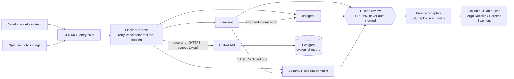
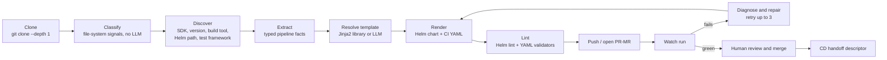
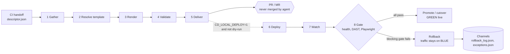

# Agentic CI/CD Pipeline Automation

**Agentic CI/CD Pipeline Automation** is an autonomous, AI-driven CI/CD transformation framework that covers both continuous integration and continuous delivery across multiple technology stacks. Specialised **platform-agents** author, deliver and repair CI/CD pipelines end to end. They are integrated with GitHub and GitLab and drive commits and pull / merge requests. They replace fragmented, manual, engineer-driven processes with a standardised, auditable, agent-orchestrated delivery pipeline. The goal is faster software delivery, better code quality and security, and higher developer productivity.

The agents retrieve and analyse source code, generate and execute tests (including Playwright-based end-to-end tests), enforce security gates, auto-remediate code vulnerabilities and test failures, and provision synthetic test data and environments, with minimal human intervention.

## Architecture Overview

Two independently deployable agents, **ci-agent** (CI) and **cd-agent** (CD), share one control plane, one pipeline harness and one system of record. A run started by a developer looks the same as a run started by an AI assistant. A third agent, the **Security Remediation Agent**, triages open findings and proposes fixes through the same harness.

Each agent solves one problem end to end: classify a repository, generate a CI/CD artefact, deliver it, watch the result and repair it if it fails. A human approves anything that touches a real pipeline or environment.

Key design principles:

- **One internal shape.** Every agent is a thin CLI / MCP entry point, then a `PipelineHarness` (retry, checkpoint / resume, structured logging), then a linear stage pipeline, then provider adapters for everything that leaves the process (git, deploy, scan, notify).
- **Human in the loop, always.** Agents open PRs / MRs and never merge them. The CD agent raises exactly one never-merged PR, and low-confidence security findings go to manual review.
- **Authoring is separate from running.** CD stages 1–5 only author and never touch a cluster. Stages 6–8 (deploy, watch, gate) are no-ops unless `CD_LOCAL_DEPLOY=1` and the run is not `--dry-run`. Each skipped stage still writes a "skipped" result.
- **Deterministic first, LLM second.** Repository classification uses file-system signals with no LLM. Templates are Jinja2 and are selected from a library. The LLM (Claude API, planned / fallback) generates a template only when none matches, and diagnoses and patches failures.
- **Blue/green by default.** Runtime gates run health, then DAST, then Playwright, and all of them block. A gate failure triggers an attributable rollback that is recorded the same way a success is.
- **Single system of record.** Agents never talk to Postgres directly or to each other's internals. Every recorded execution goes through the **Unified API** over HTTPS with a scoped token.
- **Bounded self-correction.** Failure repair is capped (lint-retry loop up to 3 attempts), then the agent escalates to a human.
- **Auditable by default.** Every agent action (ingest, triage, remediation, review outcome, rollback) is logged for compliance review.

## Architecture Diagrams

[](Agentic_CICD_Pipeline_Automation_Architecture-1_-_Platform_Overview.jpg)


| Page | Title | What it shows |
| ---- | ----- | ------------- |
| 1 | Platform Overview | Actors and inputs, the three agents on a shared harness, the human gate, provider adapters, external systems, the Unified API and Postgres, registries and guardrails |
| 2 | CI Agent | The ci-agent authoring flow (classify through repair) and the CI pipeline it generates, with the tools each stage uses |
| 3 | CD Agent | The eight CD stages, authoring vs runtime, gates, rollback, providers, guardrails and the registries |
| 4 | Security Remediation | Open finding → triage → auto-generated PR → human review → merge decision, with audit logging |
| 5 | Delivery Targets | Per-stack delivery paths (AKS, IIS, Java + Spring, COBOL / AS400) and Dev → QA → Cert → Prod promotion |

### System overview



## Request Flow

1. A developer or an AI assistant starts a run through the CLI / MCP entry point with a repository URL and a target CI platform (GitHub or GitLab). Security findings can also arrive through an API or webhook.
2. The **PipelineHarness** wraps the run with retry, checkpoint / resume and structured logging, and records every execution through the Unified API.
3. The **ci-agent** classifies the repository, authors and lints a CI pipeline, opens a PR / MR, watches the run and repairs failures. It then emits a **CD handoff descriptor**.
4. The **cd-agent** turns the handoff descriptor into a blue/green delivery pipeline and raises one never-merged PR for a human to approve.
5. When runtime stages are enabled, the cd-agent deploys, watches and gates the release. If all gates pass, GREEN is promoted. If a blocking gate fails, the release is rolled back and traffic stays on BLUE.
6. The **Security Remediation Agent** ingests open findings, triages them, and opens a fix PR for in-scope patterns. A reviewer approves before merge.

## CI Agent

Classifies a repo, generates a CI pipeline, watches it run, and diagnoses and repairs failures.

```text
classify → discover → extract → render → lint → push / open PR → watch → diagnose → repair
```



### Stages

| # | Stage | What happens |
| - | ----- | ------------ |
| 01 | Classify | Repository type: .NET Core 6/7/8, .NET Framework 4.8, COBOL, Node, Python, Spring. Uses file-system signals, no LLM. |
| 02 | Discover | Framework SDK, version, build tool, Helm path, test framework. |
| 03 | Unit test | Run the .NET tests and generate a coverage report. |
| 04 | Security scans | Inject SAST, SCA, DAST and container scans into the pipeline. |
| 05 | Generate CI YAML | Render the Helm chart and pipeline YAML from a Jinja2 template, then lint and validate them. |
| 06 | Push and open MR | Push the branch and open an MR for human review. It is never auto-merged. |
| 07 | Monitor | Watch the GitLab pipeline job until complete. On failure, diagnose and patch (lint-retry loop, up to 3 attempts), then escalate. |

### The generated CI pipeline

The pipeline the agent authors runs on the target platform (GitHub Actions or a GitLab CI runner) with these stages: select runner (Linux, Windows or self-hosted), unit tests and coverage, SAST / SCA scan, build app (Docker image or DLL), SBOM and container image scan, optional DAST scan, Playwright E2E and store artifacts.

The Playwright E2E job in CI is **non-blocking**: the worst case is a blocked merge. The CD agent's Playwright gate is a different stage and is blocking.

### Generated artifacts

Unit test results · SAST and DAST reports · SCA (dependency scanning) report · container image scan report · Software Bill of Materials (SBOM) · Helm chart package · build artifacts (Docker image, compiled binaries).

### Tools and plugins

| Area | Tools |
| ---- | ----- |
| Test and coverage | GitLab, SonarQube, .NET SDK |
| SAST / SCA | GitLab SAST and Dependency Scanning (implemented); Fortify ScanCentral and Sonatype Nexus IQ (scaffolded) |
| SBOM and container scan | syft (CycloneDX SBOM), grype / trivy (CVE scan), GitLab Container Scanning (implemented); Wiz container scan (scaffolded) |
| DAST | GitLab DAST (implemented, flagged CD only in the plugin registry); Fortify WebInspect (scaffolded) |
| E2E | Playwright in an ephemeral container with automatic teardown |
| CI YAML validation | yamllint, actionlint (GitHub Actions), `glab ci lint` (offline), GitLab CI Lint API (fallback), Python YAML parse (fallback) |
| Helm | Helm lint validates the chart structure |

## CD Agent

Authors a blue/green CD pipeline from the CI handoff and raises one human-approved PR. It never touches a live cluster itself. It is a short-lived, stateless authoring job.

```text
gather → resolve_template → render → validate → deliver → deploy → watch / gate
```

| # | Stage | Output | Notes |
| - | ----- | ------ | ----- |
| 1 | Gather | `deploy_context.json` | Reads the CI handoff descriptor. |
| 2 | Resolve template | `template_ref.json` | Picks the delivery template. |
| 3 | Render | `rendered/` | Per-app / per-env values and blue/green + health-gate manifests. |
| 4 | Validate | `validate_result.json` | Confirms every gate's failure path routes to rollback. |
| 5 | Deliver | `return_contract.json` | Raises exactly one never-merged PR for a human to approve. |
| 6 | Deploy | `runtime_manifests/` | `kubectl apply`. No-op unless `CD_LOCAL_DEPLOY=1` and not `--dry-run`. |
| 7 | Watch | `watch_result.json` | Watches the rollout. |
| 8 | Gate | `gate_result.json` | Health → DAST → Playwright, all blocking. |

Stages 1–5 are authoring only and never touch a cluster (ADR-CD-001 v2). Stages 6–8 each still write a "skipped" result when they are no-ops.



### Registries

| Registry | Contents |
| -------- | -------- |
| Strategy registry (default: blue-green) | blue-green (exposure: none, default), canary (exposure: subset), rolling (exposure: full) |
| Gate registry (`deploy-catalog.json`) | health (blocking, `GET /health`), DAST (blocking, ZAP locally, Fortify stub), Playwright (blocking, ephemeral container). Default order: health → DAST → Playwright. |

### Providers (profile-selected)

| Profile | Providers |
| ------- | --------- |
| Local | local-argo (kubectl + Argo Rollouts on kind), gitea, prem-loki, mailhog |
| Production | harness, argo-rollouts, gitlab, dynatrace-splunk, ses-acs |

### Guardrails

`no_self_merge` · `retry_cap ≤ 3` · `channel_separation` (the runtime `rollback_log.json` is kept apart from the audit-log `exceptions.json`) · local deploy is scoped to the local profile.

### Two Playwright stages, deliberately different

The CD agent's Playwright gate is **blocking**. It runs at deploy time and its failure rolls the release back. The CI agent's Playwright E2E job is **non-blocking**. It runs inside the pipeline the CI agent authored, where the worst case is a blocked merge.

## Security Remediation Agent

Pilot scope covers SCA and SAST findings. The flow is: open finding → triage → auto-generated PR → human review → merge decision.

| Component | Responsibility |
| --------- | -------------- |
| **Findings ingestion** | Secure API / webhook access to open findings. Normalises scanner output into a consistent CWE / CVSS-tagged schema. |
| **Triage Agent** | Classifies findings by severity and fix pattern, with confidence scoring. Low-confidence findings are routed to manual review. |
| **Remediation Agent** | Auto-generates a fix and opens a PR with rationale for in-scope patterns (dependency / SCA uplifts). |
| **Human-in-the-loop gate** | A reviewer approves before merge. |
| **Audit log** | End-to-end logging across ingestion, triage, remediation and review, with pilot metrics captured. |

For COBOL, the security scan uses the client-recommended toolset. DAST is not needed for AS400.

## Delivery Scope and Pilot Deliverables

### CI/CD deployment: automation with zero touch

| Activities | Deliverables |
| ---------- | ------------ |
| Build GitHub Actions CI pipelines for IIS .NET Legacy and AKS | End-to-end .NET pipeline pilot (Week 4 demo: CI + CD + rollback) |
| Integrate Nexus artifact management for versioned deployments across all stacks | Nexus versioned artifact store for all three stacks |
| Configure Harness CD for IIS app pool management, file deployment and config promotion | Automated rollback mechanism with forced-failure validation |
| IaC scanning (AKS), secrets scanning (all repos) and Helm tag automation | Environment promotion strategy document (Dev → Prod) |
| Environment promotion gates: Dev → QA → Cert → Prod with approval workflows | GitHub Actions pipeline templates reusable across the 1,400-repo full estate |
| End-to-end CI/CD for AS400* | |

### Security remediation

| Activities | Deliverables |
| ---------- | ------------ |
| Confirm target app / repo and finding type (SCA / SAST); secure API / webhook access | Agentic pipeline demonstrated end to end: open finding → triage → auto-generated PR → human review → merge decision |
| Build the findings ingestion pipeline (CWE / CVSS-tagged schema) | Triage agent output validated: severity and fix-pattern classification with confidence scoring |
| Triage Agent: classify by severity and fix pattern; route low-confidence findings to manual review | Auto-remediation capability for vulnerability classes (dependency / SCA and SAST) and DAST review |
| Remediation Agent: auto-generate a fix and open a PR with rationale | Full audit log of every agent action for compliance review |
| Human-in-the-loop gate: reviewer approval before merge | Findings report with scale-readiness recommendation (more finding types, platforms and repos after the pilot) |
| End-to-end audit logging; capture pilot metrics | |
| Use the client-recommended toolset for COBOL security scan | |

## Components

### Agents

| Agent | Role | Entry |
| ----- | ---- | ----- |
| **ci-agent** | Classifies a repo, generates and lints a CI pipeline, opens a PR / MR, watches the run, diagnoses and repairs failures | CLI / MCP |
| **cd-agent** | Authors a blue/green CD pipeline from the CI handoff, validates gate failure paths, raises one never-merged PR, runs runtime gates and rolls back on failure | CLI / MCP |
| **Security Remediation Agent** | Ingests, triages and remediates SCA / SAST findings behind a human review gate | CLI / MCP |

### Platform services

| Component | Responsibility |
| --------- | -------------- |
| **PipelineHarness** | Shared runtime for every agent: retry, checkpoint / resume, structured logging. |
| **Unified API** | The only path to the system of record. HTTPS with a scoped token. |
| **Postgres** | System of record for runs, stage results, audit log and exceptions. |
| **Provider adapters** | Git, deploy, scan and notify adapters for everything that leaves the process. |
| **Jinja2 template library** | CI templates named `<stack>-<platform>-v1.yml`, selected by stack and platform. |
| **LLM (Claude API)** | Template generation, failure diagnosis and patching, finding triage and fix generation. Planned / fallback. |
| **Nexus** | Versioned artifact store across the delivery stacks. |

## Technology Summary

| Area | Technology |
| ---- | ---------- |
| Agent interface | CLI and Model Context Protocol (MCP) |
| Pipeline templating | Jinja2 |
| LLM | Claude API (planned / fallback) |
| Source control | GitHub, GitLab, Gitea (local) |
| CI platforms | GitHub Actions, GitLab CI |
| CD and progressive delivery | Harness CD, Argo Rollouts, kubectl, Helm |
| Runtime targets | AKS, IIS, Java + Spring, COBOL / AS400 |
| Security | GitLab SAST / Dependency / Container / DAST, Fortify, Sonatype Nexus IQ, Wiz, SonarQube, syft, grype, trivy, ZAP |
| Testing | Playwright, unit test and coverage tooling |
| Artifacts | Nexus, Docker images, Helm charts, SBOM (CycloneDX) |
| Observability and notify | Dynatrace, Splunk, Loki, SES / ACS, MailHog (local) |
| System of record | Unified API + Postgres |

## Scope Notes

- Synthetic test data and environment provisioning, and auto-remediation of test failures, are part of the programme scope. The supplied design pages do not detail them yet, so they are not drawn in the diagrams.
- Some tools are marked **scaffold** in the plugin registry (Fortify, Sonatype, Wiz). They are wired into the design but not yet implemented.
- Items marked with `*` (AS400 CI/CD) are flagged in the delivery plan.
